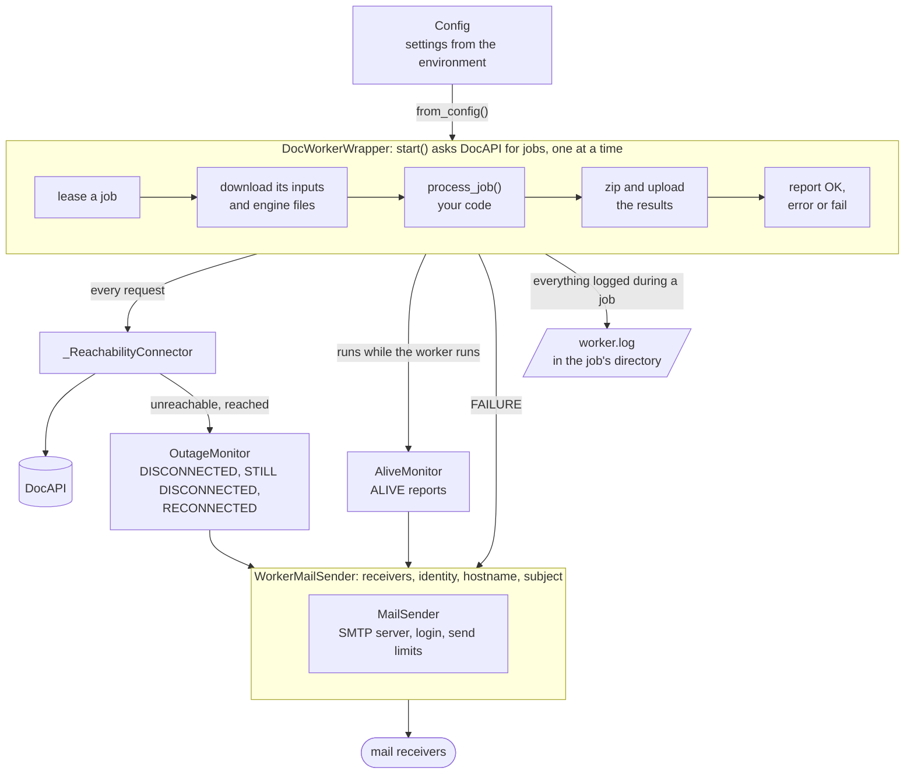

# Writing a DocAPI worker

A worker is a subclass of `DocWorkerWrapper` (`doc_worker_wrapper.py`). The
wrapper does everything around a job:

- asks DocAPI for a job and leases it;
- downloads its images, ALTO, PAGE, meta JSON and engine files;
- zips and uploads the results, and reports the outcome;
- mails its own failures, DocAPI outages and ALIVE reports, when mail is set up.

The subclass implements only the processing. `dummy_worker.py` is a complete
example, which copies the inputs to the results.



- **`Config` and `from_config()`** build the worker from the environment; see
  [Configuring and starting it](#configuring-and-starting-it).
- **The pipeline** runs once per job. Only `process_job()` is yours; see
  [Processing a job](#processing-a-job).
- **`_ReachabilityConnector`** passes every request to DocAPI and tells the
  `OutageMonitor` whether DocAPI answered.
- **The job's log** gets everything logged while the job runs; see
  [The job's log](#the-jobs-log).
- **Monitoring** mails failures, DocAPI outages and ALIVE reports when mail
  is set up; see [Monitoring](#monitoring).

## Processing a job

Implement `process_job`. The wrapper calls it with keyword arguments, once per
job:

```python
from doc_worker.doc_worker_wrapper import DocWorkerWrapper, WorkerResponse

class MyWorker(DocWorkerWrapper):
    def process_job(self, job, images_dir, result_dir,
                    alto_dir=None, page_xml_dir=None, meta_file=None, engine_dir=None):
        ...  # read the inputs, write the results into result_dir
        return WorkerResponse.ok()
```

- **Inputs and results:**
  - `images_dir` holds the job's images.
  - `alto_dir`, `page_xml_dir`, `meta_file` and `engine_dir` are `None` when the
    job has no such input.
  - Everything written to `result_dir` is zipped and uploaded as the result.
- **Logging:** log as usual. Everything logged while the job runs goes into
  the job's log; see [The job's log](#the-jobs-log).
- **The outcome:** return one of these.
  - `WorkerResponse.ok()`: the job is done.
  - `WorkerResponse.error(final_log, final_log_user)`: a retryable error.
  - `WorkerResponse.fail(final_log, final_log_user)`: a permanent failure.

  `final_log` is the technical report for admins, and `final_log_user` the
  report for the job's owner.

  If `process_job` raises an exception, the wrapper reports a retryable error
  for you. The job gets the texts of the `ERROR_PROCESS_JOB_LOG` and
  `ERROR_PROCESS_JOB_LOG_USER` settings, by default "Processing failed due to
  an internal error". The exception and its traceback are logged and appended
  to the technical report, never to the owner's. Return `fail` yourself when
  retrying cannot help, and give your own reports. Pass `exception=` to
  `error` or `fail` to get its traceback into the technical report too.
- **After each job:** to act once every leased job is done (log or mail a
  summary, say), override `on_job_finished`. It is called whether the job
  succeeded or failed.

## The job's log

Each job has its own log file, `worker.log` in the job's directory. From the
moment the job is acquired until it is done, the wrapper attaches the job's
handler to the root logger. The log then holds the messages of the wrapper, of
your code and of the libraries you use, each once.

- **Set the root level** to what the log should hold, e.g.
  `logging.basicConfig(level=logging.INFO)`. The default, WARNING, drops INFO
  and DEBUG messages before any handler sees them.
- **Other threads:** messages of other threads during the job go into its log
  too. Only the ALIVE reports, which run beside every job, are left out.

The log takes the format of the first root handler that has one. For another
format or level, override `job_log_handler(path)`, which creates the handler.
For a different scope, override `job_logging`, a context manager that attaches
the handler for the duration of the job. For example, to log only your own
loggers:

```python
from contextlib import contextmanager


class ThumbnailWorker(DocWorkerWrapper):
    @contextmanager
    def job_logging(self, job_log_file_handler):
        own_logger = logging.getLogger("thumbnail_worker")
        own_logger.addHandler(job_log_file_handler)
        try:
            yield
        finally:
            own_logger.removeHandler(job_log_file_handler)
```

## Monitoring

The worker watches three things. It always logs them, and it emails them when
mail is set up:

- **Failures** that a job's report cannot carry, such as a report DocAPI never
  received or the worker stopping unexpectedly: a FAILURE email.
- **Whether DocAPI can be reached:** DISCONNECTED when it cannot (after
  `OUTAGE_GRACE_SECONDS` while idle, at once during a job), a STILL
  DISCONNECTED reminder every `OUTAGE_MAIL_INTERVAL_SECONDS`, and
  RECONNECTED when it is back, with what happened to a job whose outcome had
  to wait. Results that could not be uploaded in the outage are uploaded
  then, so the job is not processed again. A request that times out or gets
  a 504 while DocAPI still answers a small request was only slow, e.g. a
  large upload: it fails the job as an ordinary error, not as an outage. Raise
  `API_READ_TIMEOUT_SECONDS`, and the proxy's timeout, for large results.
- **That the worker is alive:** an ALIVE email at startup and then once a
  day, with its uptime, when it last polled for a job and its active job.

The texts of the outage and ALIVE emails are each in one place,
`OutageMonitor._message()` and `AliveMonitor._message()`.

To get the emails, set the mail server, a sender and the receivers; the
worker refuses to start with only some of them:

```sh
MAIL_SERVER=smtp.example.org
MAIL_SENDER_MAIL=worker@example.org
MAIL_RECEIVER_MAILS=admin@example.org,ops@example.org
# Only if the server needs a login; MAIL_PORT and MAIL_SECURITY as it requires.
MAIL_USERNAME=worker
MAIL_PASSWORD=...
```

Optional:
- `JOB_HISTORY_PATH` adds job statistics to the ALIVE emails. A line of
  the history file that cannot be read is left out of them: the next ALIVE
  email lists it with its line number and reason, and later ones only count
  it under `all time`. To clear the count, fix or remove the line and delete
  the statistics cache beside the file (`<name>.stats.json`), which is then
  rebuilt;
- `ALIVE_MAIL_STARTUP` and `ALIVE_MAIL_INTERVAL_SECONDS` change when they are sent;
- `WORKER_IDENTITY` names the worker, instead of its API key's label;
- `MAIL_SUBJECT` sets the subject of the emails, by default
  `[{identity}] {status} ({hostname})`. Its placeholders:
  - `{identity}`: the worker's name;
  - `{hostname}`: by default the host name the system reports
    (`socket.gethostname()`); in a Docker container that is the container's
    ID unless it was given a hostname. `WORKER_HOSTNAME` replaces it;
  - `{status}`: FAILURE, DISCONNECTED, STILL DISCONNECTED, RECONNECTED or ALIVE;
  - `{time}`: the UTC time, with a format if you like, e.g. `{time:%Y-%m-%d %H:%M}`.

  A subject with any other placeholder is rejected when the worker is built.

`.env_example` lists them all. Emails about jobs come from DocAPI, not from
the worker.

## Configuring and starting it

Settings come from the environment through `config.py`. `.env_example` lists
every setting with its default. `from_config` builds the worker from a
checked `Config`, including the connector, the mail sender and the ALIVE
mail:

```python
from doc_worker.config import Config

MyWorker.from_config(Config()).start()
```

- **Overriding settings:** `Config({"POLLING_INTERVAL": "1"})` replaces the
  environment variable, e.g. from a command-line argument. Overrides are text,
  as in the environment, and an empty value means unset. An unknown name is an
  error. See `build_config` in `dummy_worker.py`.
- **Building it without the config:** you can also pass the constructor's
  arguments to the class directly.

## Settings of your own

Extend `Config` with your settings. Read them in `read()` and check them in
`check()`, each calling `super()` first. Your settings then take overrides and
are checked like the wrapper's.

`from_config` passes each of your settings to the constructor parameter of the
same name in lower case: `THUMBNAIL_MODEL_PATH` to `thumbnail_model_path`. A
setting with no such parameter is an error. The settings of `Config` itself go
only to the wrapper.

## Example

A worker that makes a thumbnail of each image of a job with a model.
`my_models.ThumbnailModel` stands for your model library. The settings of its
own are the model file, `THUMBNAIL_MODEL_PATH`, and the size and format of the
thumbnails, `THUMBNAIL_SIZE` and `THUMBNAIL_FORMAT`. `from_config` passes the
path to the constructor, which loads the model:

```python
import os

import cv2
from my_models import ThumbnailModel  # your model library

from doc_worker.config import Config
from doc_worker.doc_worker_wrapper import DocWorkerWrapper, WorkerResponse


class ThumbnailConfig(Config):
    def read(self):
        super().read()
        # The model file that makes the thumbnails. Required.
        self.THUMBNAIL_MODEL_PATH = self._str("THUMBNAIL_MODEL_PATH", None)
        # The longest side of a thumbnail, in pixels.
        self.THUMBNAIL_SIZE = self._nonnegative_int("THUMBNAIL_SIZE", 256)
        # The file format of the thumbnails: jpg or png.
        self.THUMBNAIL_FORMAT = self._str("THUMBNAIL_FORMAT", "jpg")

    def check(self):
        super().check()
        if not self.THUMBNAIL_MODEL_PATH or not os.path.isfile(self.THUMBNAIL_MODEL_PATH):
            raise ValueError("THUMBNAIL_MODEL_PATH must name an existing model file")
        if self.THUMBNAIL_SIZE < 16:
            raise ValueError("THUMBNAIL_SIZE must be at least 16")
        if self.THUMBNAIL_FORMAT not in ("jpg", "png"):
            raise ValueError("THUMBNAIL_FORMAT must be jpg or png")


class ThumbnailWorker(DocWorkerWrapper):
    """Makes a thumbnail of each image of a job with a model."""

    def __init__(self, *args, thumbnail_model_path, thumbnail_size, thumbnail_format, **kwargs):
        super().__init__(*args, **kwargs)
        self.model = ThumbnailModel.load(thumbnail_model_path)
        self.thumbnail_size = thumbnail_size
        self.thumbnail_format = thumbnail_format

    def process_job(self, job, images_dir, result_dir, **other_inputs):
        for name in sorted(os.listdir(images_dir)):
            image = cv2.imread(os.path.join(images_dir, name))
            if image is None:
                return WorkerResponse.fail(f"cv2 cannot read {name}", f"The image {name} cannot be read")
            thumbnail = self.model.thumbnail(image, self.thumbnail_size)
            stem = os.path.splitext(name)[0]
            cv2.imwrite(os.path.join(result_dir, f"{stem}.{self.thumbnail_format}"), thumbnail)
        return WorkerResponse.ok()


if __name__ == "__main__":
    ThumbnailWorker.from_config(ThumbnailConfig()).start()
```

```sh
API_URL=https://docapi.example.org WORKER_KEY_FILE=worker.key BASE_DIR=data \
THUMBNAIL_MODEL_PATH=thumbnails.model THUMBNAIL_SIZE=512 python thumbnail_worker.py
```

## Building something before the worker exists

The constructor can instead take a model that is already loaded. Other code
and tests can then pass a model of their own, such as a small or fake one,
without a model file. `from_config` then has to load the model first: override
`subclass_args` to build it from the settings. The override returns all of
your own arguments itself, as nothing is passed automatically any more, and the
wrapper's arguments are still built as usual.

The config and `process_job` stay as above:

```python
class ThumbnailWorker(DocWorkerWrapper):
    """Makes a thumbnail of each image of a job with a model it is given."""

    def __init__(self, *args, model, thumbnail_size, thumbnail_format, **kwargs):
        super().__init__(*args, **kwargs)
        self.model = model
        self.thumbnail_size = thumbnail_size
        self.thumbnail_format = thumbnail_format

    @classmethod
    def subclass_args(cls, config):
        return {"model": ThumbnailModel.load(config.THUMBNAIL_MODEL_PATH),
                "thumbnail_size": config.THUMBNAIL_SIZE,
                "thumbnail_format": config.THUMBNAIL_FORMAT}
```

## Tests

Tests never send mail: the repository's `conftest.py` removes the `MAIL_*`
settings and blocks SMTP connections (see `AGENTS.md`).
